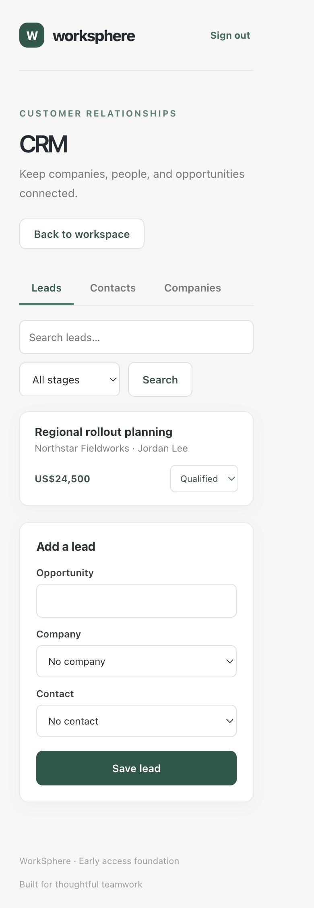
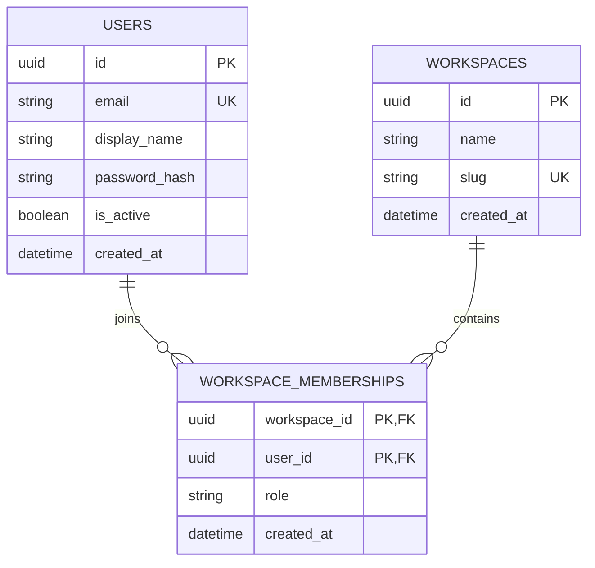
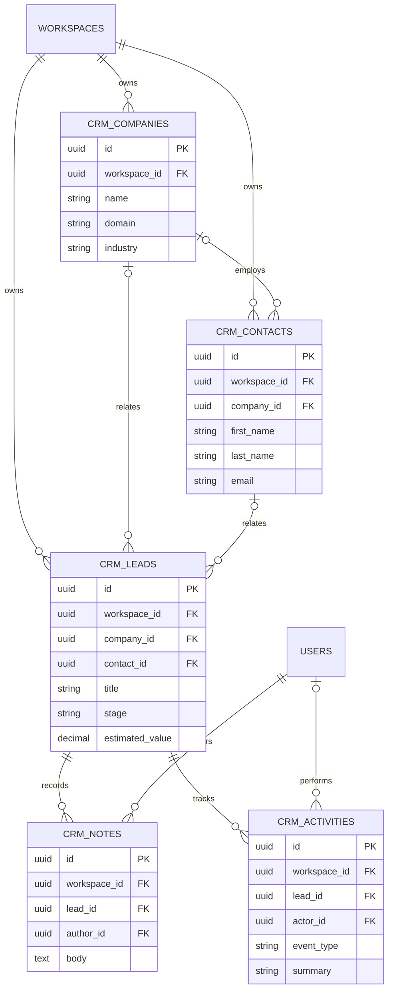
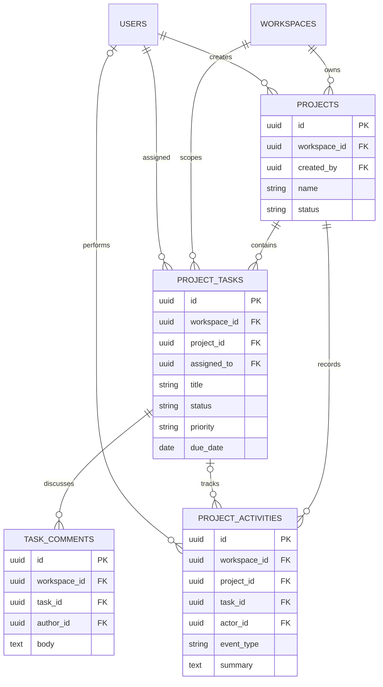
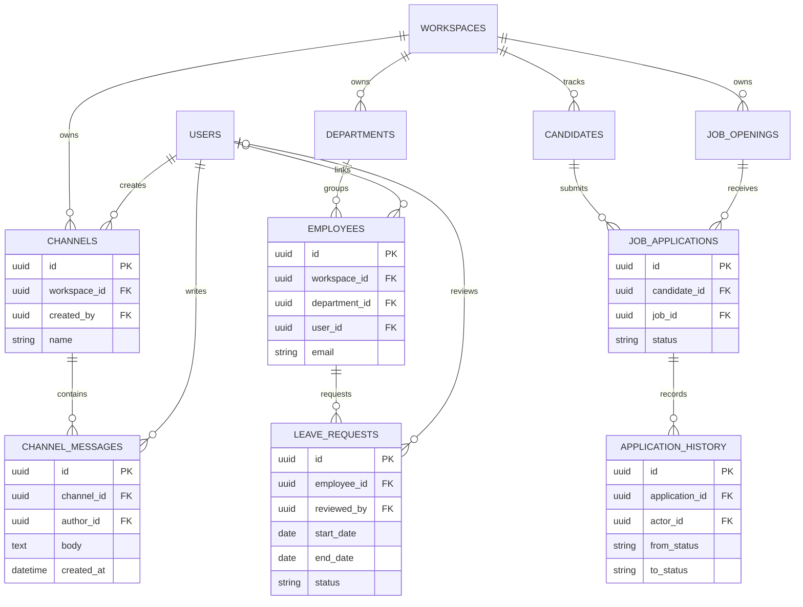

# WorkSphere

WorkSphere is an original business-application portfolio project. It is being
built as a modular monolith: one React client, one FastAPI service, and one
PostgreSQL database. The application is developed incrementally and does not
claim production readiness or enterprise scale.

## Implemented scope (Milestones 1–8)

- React, TypeScript, and Vite frontend with an API readiness indicator.
- FastAPI liveness and database-readiness endpoints.
- PostgreSQL 17 for local development through Docker Compose.
- SQLAlchemy workspace, user, and membership models with an Alembic migration.
- Account registration/login using Argon2 password hashes and short-lived,
  HttpOnly cookie sessions with CSRF protection; a separate bearer-token
  endpoint is available to API clients.
- Workspace membership checks and owner/admin permission gates enforced by
  API dependencies.
- A protected workspace view with login/register forms and a focused backend
  and frontend test suite.
- A workspace-scoped CRM vertical slice for companies, contacts, leads, lead
  notes, and activity history, including search, filtering, pagination,
  duplicate handling, and lead-stage updates.
- An authenticated CRM interface with accessible create forms, loading and
  empty states, search, stage filtering, pagination, and API error feedback.
- Workspace-scoped projects with task assignment, priorities, due dates,
  project/task statuses, comments, and activity history.
- An authenticated project workspace with project/task search and filters,
  assignment controls, due-date display, status updates, and task discussion.
- Workspace-scoped team channels with five-second message polling and an
  authenticated message composer.
- An HR workspace for departments, synthetic employee profiles, and leave
  request submission/review. HR endpoints are restricted to workspace owners
  and admins.
- An applicant-tracking workspace for job openings, candidates, applications,
  stage transitions, and application status history.
- A responsive Team screen that brings communication, people operations, and
  hiring together, with loading, empty, and API error feedback.
- An explicitly triggered project status-draft assistant behind a provider
  interface, using a local deterministic mock with no external data transfer.
- Request IDs, structured request logs, generic unexpected-error responses,
  an Actions CI workflow, and a synthetic local read benchmark.

## Repository structure

```text
WorkSphere/
├── backend/
│   ├── app/
│   │   ├── config.py
│   │   ├── database.py
│   │   ├── dependencies.py
│   │   ├── main.py
│   │   ├── observability.py
│   │   ├── security.py
│   │   ├── api/
│   │   ├── models/
│   │   ├── schemas/
│   │   └── services/
│   ├── benchmarks/
│   │   └── api_read_benchmark.py
│   ├── migrations/
│   │   └── versions/
│   ├── scripts/
│   │   └── seed_demo.py
│   ├── tests/
│   │   ├── conftest.py
│   │   ├── test_database.py
│   │   ├── test_auth.py
│   │   ├── test_crm.py
│   │   ├── test_projects.py
│   │   ├── test_people_modules.py
│   │   ├── test_seed_demo.py
│   │   ├── test_config.py
│   │   └── test_health.py
│   ├── alembic.ini
│   ├── pytest.ini
│   └── requirements.txt
├── frontend/
│   ├── src/
│   │   ├── App.tsx
│   │   ├── App.test.tsx
│   │   ├── CrmPage.tsx
│   │   ├── CrmPage.test.tsx
│   │   ├── ProjectsPage.tsx
│   │   ├── ProjectsPage.test.tsx
│   │   ├── TeamPage.tsx
│   │   ├── TeamPage.test.tsx
│   │   ├── main.tsx
│   │   ├── styles.css
│   │   └── testSetup.ts
│   ├── index.html
│   ├── package-lock.json
│   ├── package.json
│   ├── tsconfig.json
│   └── vite.config.ts
├── .env.example
├── .gitignore
├── .github/
│   └── workflows/
│       └── ci.yml
├── screenshots/
│   └── crm.png
├── DEVELOPMENT_LOG.md
└── docker-compose.yml
```

## Local setup

Prerequisites: Node.js 20.19+ (or 22.12+), Python 3.11+, and Docker Compose
with a running Docker engine.

1. Copy `.env.example` to `.env`. Its credentials are for a local disposable
   database only. Replace `POSTGRES_PASSWORD`, update the password in
   `DATABASE_URL` to match, and set `JWT_SECRET_KEY` to a fresh value of at
   least 32 characters (for example, generate one with `openssl rand -hex 32`)
   before using the app outside isolated local development.
2. Start PostgreSQL from this directory:

   ```sh
   docker compose up -d db
   ```

3. Install backend dependencies and start the API:

   ```sh
   python3 -m venv .venv
   . .venv/bin/activate
   python -m pip install -r backend/requirements.txt
   cd backend
   alembic upgrade head
   cd ..
   uvicorn app.main:app --app-dir backend --reload
   ```

4. In a separate terminal, install frontend dependencies and run Vite:

   ```sh
   cd frontend
   npm ci
   npm run dev
   ```

The frontend is available at <http://localhost:5173>. The Vite development
server proxies `/api` requests to <http://localhost:8000>. Open
<http://localhost:8000/docs> for the generated OpenAPI reference.

### Optional local demo workspace

After applying migrations, you can add deterministic synthetic records across
CRM, Projects, Communication, HR, and ATS. The seed command refuses to run
unless explicitly enabled, requires a password supplied only through the
environment, and accepts only SQLite or a loopback database host. It never
resets an existing password or modifies an existing demo workspace owned by
someone else. When rerunning it for an existing demo account, enter that
account's current password. In a Bash shell from the `backend/` directory:

```sh
export WORKSPHERE_ENABLE_DEMO_SEED=true
read -s -p "Choose a local demo password (12+ characters): " WORKSPHERE_DEMO_PASSWORD
echo
export WORKSPHERE_DEMO_PASSWORD
python -m scripts.seed_demo
unset WORKSPHERE_ENABLE_DEMO_SEED WORKSPHERE_DEMO_PASSWORD
```

Sign in with `demo@example.com` and the password you just entered. This
account and the seeded people, companies, candidates, and activity are for
local development only. Do not enable the seed against shared or hosted
databases.

## Screenshot

This responsive screenshot was captured from the running application using
the synthetic local demo workspace. It is not a mockup.



## Checks

Run backend tests and lint, then frontend tests and a type-checked build:

```sh
.venv/bin/python -m pytest -q backend/tests
cd backend
../.venv/bin/ruff check --select E4,E7,E9,F app tests benchmarks scripts
cd ../frontend
npm ci
npm test -- --run
npm run build
```

Apply or roll back database schema changes from the backend directory:

```sh
cd backend
alembic upgrade head
alembic downgrade -1
```

Run the repeatable local API read benchmark from `backend/`:

```sh
../.venv/bin/python -m benchmarks.api_read_benchmark \
  --iterations 50 --tasks 100
```

The harness generates synthetic records in in-memory SQLite, warms up each
route five times, and reports measured median and p95 response times for
project/task list requests. These local measurements are not representative
of PostgreSQL or production deployments and must not be presented as such.

`GET /api/health/live` reports whether the API process is responding.
`GET /api/health/ready` also checks PostgreSQL and returns HTTP 503 when the
database is not reachable. The readiness response does not include connection
details.
HTTP responses include an `X-Request-ID`; valid IDs supplied by callers are
preserved and invalid values are replaced. Structured JSON request logs record
method, path, status, duration, and request ID without query strings or
request bodies. Unexpected server errors are logged with the correlation ID
and return a generic message to clients.

## Architecture and design decisions

```text
Browser (React/TypeScript)
  └── same-origin HttpOnly session cookie + CSRF header → FastAPI routes
                                                            └── SQLAlchemy → PostgreSQL
```

The backend is a modular monolith rather than a collection of services: one
deployable API keeps early development and local operation straightforward.
Separate services would only be considered when there is a demonstrated need
for independent scaling, deployment, fault isolation, or ownership boundaries.
The SQLAlchemy engine is configured once and uses `pool_pre_ping` to detect
stale database connections. Readiness is separate from liveness so a live
process with an unavailable database can be distinguished operationally.
Alembic owns schema evolution; migrations are committed as reviewed source
files instead of creating or modifying tables at application startup.

The relational model includes:

- `workspaces`, with a unique human-readable slug.
- `users`, with unique email and a required password-hash storage column.
- `workspace_memberships`, associating users and workspaces using a composite
  primary key, cascading foreign keys, a database-constrained role, and a
  user lookup index.



The CRM adds workspace-scoped `crm_companies`, `crm_contacts`,
`crm_leads`, `crm_notes`, and `crm_activities` tables. Company/contact
relationships are nullable so records can be created before all associations
are known. Notes and activity entries point to exactly one company, contact,
or lead, enforced by a database check constraint. Case-insensitive indexes
prevent duplicate company names and non-null contact emails within a
workspace. Leads use a constrained stage vocabulary and nonnegative estimated
values.



Project work is represented by `projects`, `project_tasks`, `task_comments`,
and `project_activities`. Each record carries the workspace scope; assignees
must be active workspace members. Projects use `active`, `on_hold`, or
`completed` status. Tasks use `todo`, `in_progress`, or `done`, a
`low`/`medium`/`high` priority, and an optional due date. Status constraints,
assignee/project/user foreign keys, and indexes support project task queues
and task history. Status changes and the corresponding audit entries are
persisted in the same transaction.



Communication is modeled by `channels` and `channel_messages`; messages are
workspace-scoped, belong to one channel, and have an author. HR uses
`departments`, `employees`, and `leave_requests`; employee profiles can be
associated with a department and optionally a user account. Leave requests
retain their reviewer when present. ATS uses `job_openings`, `candidates`,
`job_applications`, and `application_history`. An application joins one
candidate to one opening, with a unique candidate/opening pair; history rows
preserve its status transitions.



Registration creates a user, workspace, and owner membership in one database
transaction. Email addresses are normalized before persistence, and duplicate
email or workspace-slug conflicts return HTTP 409. API password hashes use the
Argon2id implementation selected by `pwdlib`; the application never returns
the hash. Login failures use a common response for an unknown email and a bad
password. Browser registration and login set a short-lived `HttpOnly`,
`SameSite=Lax` session cookie; the JWT is not returned in browser JSON or
stored in Web Storage. A session-bound, signed double-submit CSRF cookie is
sent in `X-CSRF-Token` on unsafe requests and verified by the API. Explicit
bearer credentials remain supported for API clients. Protected routes verify
the session/token and current user, then look up membership and role from the
database so role changes take effect without waiting for a token to expire.

## Authentication API

- `POST /api/auth/register` — validate account and workspace details, create
  the owner membership atomically and set a browser session cookie.
- `POST /api/auth/login` — verify credentials and set a browser session cookie.
- `POST /api/auth/token` — verify credentials and return a bearer token for
  non-browser API clients; protect and store that token as a credential.
- `POST /api/auth/logout` — validate CSRF and clear the browser session
  cookies.
- `GET /api/auth/me` — return the current authenticated user.
- `GET /api/workspaces/current` — return a workspace the current user belongs
  to.
- `GET /api/workspaces/{workspace_id}/members` — list members for owners and
  admins only.
- `PATCH /api/workspaces/{workspace_id}/members/{user_id}/role` — allow only
  the workspace owner to grant `admin` or `member` roles. The API does not
  permit promoting a member to owner.

The OpenAPI page at <http://localhost:8000/docs> documents request and response
shapes. Registration, login, and token issuance accept JSON bodies. Browser
requests use the same-origin session cookie; cookie-authenticated `POST`,
`PUT`, `PATCH`, and `DELETE` requests require a matching CSRF header.
Explicit bearer-authenticated API requests are not subject to cookie CSRF
checks because browsers do not attach their bearer header automatically.

## CRM API

Every CRM route is workspace-scoped below
`/api/workspaces/{workspace_id}/crm` and requires an authenticated workspace
member. Membership and role checks run on the backend. The current CRM role
policy permits owner, admin, and member roles to use CRM routes.

- `GET, POST /companies` — search/paginate companies and create one.
- `GET, POST /contacts` — search/paginate contacts, optionally filter by
  company, and create a contact.
- `GET, POST /leads` — search/paginate leads, filter by stage, choose a
  supported sort order, and create a lead.
- `PATCH /leads/{lead_id}` — update lead fields; stage changes are recorded as
  activity entries in the same transaction.
- `GET, POST /leads/{lead_id}/notes` — read and add lead notes.
- `GET /leads/{lead_id}/activities` — read the lead's newest-first history.

List responses include `items`, `page`, `page_size`, and `total`. Search is
case-insensitive and treats user input literally rather than as a SQL wildcard.
Associated companies, contacts, and assignees are validated against the same
workspace before writes. Duplicate company names and contact emails return
HTTP 409; invalid input returns validation errors without echoing sensitive
request values.

## Projects API

Project routes live under `/api/workspaces/{workspace_id}/projects` and
require an authenticated workspace member. The API validates task assignees
against active workspace memberships and hides projects/tasks outside the
current workspace.

- `GET, POST /` — search/filter and paginate projects, or create a project.
- `PATCH /{project_id}` — update project details/status; changes create
  activity entries atomically.
- `GET /members` — return project-assignee choices (member IDs and display
  names only).
- `GET, POST /{project_id}/tasks` — search/filter by task status, priority, or
  due date (`due_before`); paginate tasks or create one.
- `PATCH /{project_id}/tasks/{task_id}` — update task fields; status and
  metadata changes create activity entries atomically.
- `GET, POST /{project_id}/tasks/{task_id}/comments` — list or add comments.
- `GET /{project_id}/activities` — return newest-first project/task events.

## Team, HR, and applicant-tracking APIs

Communication endpoints live under
`/api/workspaces/{workspace_id}/communication`. Workspace members can list
and create channels, and list or post messages for channels in that workspace.
The Team UI polls the selected channel every five seconds; it does not use
WebSockets.

- `GET, POST /channels` — list or create channels.
- `GET, POST /channels/{channel_id}/messages` — list up to 100 chronological
  messages or post a message.

HR endpoints live under `/api/workspaces/{workspace_id}/hr` and intentionally
require the `owner` or `admin` workspace role because employee and leave data
is sensitive.

- `GET, POST /departments` — list or create departments.
- `GET, POST /employees` — list or create employee profiles.
- `GET, POST /leave-requests` — list requests (optionally filter by status) or
  submit a request for an employee in this workspace.
- `PATCH /leave-requests/{request_id}` — approve or reject a pending request.

Applicant-tracking endpoints live under
`/api/workspaces/{workspace_id}/ats`. All workspace roles may access this
portfolio slice; candidates and job associations are checked within the
workspace.

- `GET, POST /jobs` — list or create job openings.
- `GET /candidates` and `POST /candidates` — list candidates or create a
  candidate with an initial application and `applied` history entry.
- `GET /applications` — list workspace applications.
- `PATCH /applications/{application_id}` — move an application to a supported
  stage and record the transition.
- `GET /applications/{application_id}/history` — view stage history.

These are intentionally small workflow slices. They do not implement channel
membership/visibility rules, threaded replies, user-linked HR identities,
payroll, interview scheduling, resume storage, or fine-grained candidate
permissions. All demo employee/candidate data should be synthetic.

## Project update assistant

- `POST /api/workspaces/{workspace_id}/assistant/projects/{project_id}/status-draft`
  builds a draft from the selected workspace project, task counts, and up to
  five recent activity summaries.
- The route uses the same workspace-membership authorization as project
  routes and returns 404 for a project outside the workspace.
- The browser only sends this request after the user selects **Generate
  draft**. The draft remains editable in the page and is not saved or shared
  automatically.
- A `ProjectSummaryProvider` interface separates input/context gathering from
  draft generation. `MockProjectSummaryProvider` is the configured default:
  deterministic, local, and usable in tests without credentials or network
  access. There is no real model/provider integration and no private project
  data is sent to a third party.
- The API validates nonblank output up to 1,200 characters and returns
  explicit errors for invalid provider output and provider unavailability.
  Users are told to review the text because it may omit context or be
  inaccurate. The mock demonstrates the integration boundary, not AI quality.

## Third-party dependencies and licenses

Direct runtime and development dependencies currently used by the project:

| Component | License |
| --- | --- |
| React and React DOM | MIT |
| `@types/react` and `@types/react-dom` | MIT |
| Vite and `@vitejs/plugin-react` | MIT |
| TypeScript | Apache-2.0 |
| FastAPI | MIT |
| Uvicorn | BSD-3-Clause |
| Pydantic | MIT |
| Pydantic Settings | MIT |
| SQLAlchemy | MIT |
| Alembic | MIT |
| Psycopg 3 (`psycopg[binary]`) | LGPL-3.0-with-exceptions |
| libpq (used by the Psycopg binary distribution) | PostgreSQL License |
| PyJWT | MIT |
| pwdlib | MIT |
| argon2-cffi | MIT |
| email-validator | Unlicense |
| python-dotenv | BSD-3-Clause |
| pytest | MIT |
| Ruff | MIT |
| HTTPX | BSD-3-Clause |
| Vitest | MIT |
| React Testing Library, user-event, and jest-dom | MIT |
| jsdom | MIT |
| PostgreSQL 17 container image | PostgreSQL License |

Transitive packages may be added by package managers; review their licenses
before distributing a build. Exact frontend dependency resolutions are
recorded in `frontend/package-lock.json` after installation. License metadata
is available from each dependency's package registry and upstream repository.

## Security and limitations

- CRM, project management, communication, HR, and applicant tracking are
  workspace-scoped portfolio slices; their workflows are not comprehensive.
  There are no invitations, password reset, email verification, or rate
  limits.
- CRM/project access is workspace-scoped on the backend. There are no
  finer-grained record permissions, ownership-based access rules, delete/
  archive endpoints, task dependencies, or file attachments yet.
- Browser sessions expire after 30 minutes. There is no refresh-token or
  server-side revocation mechanism; signing out clears browser cookies but
  does not invalidate a previously copied bearer token before expiry.
- Browser session cookies use `HttpOnly` and `SameSite=Lax`;
  `SESSION_COOKIE_SECURE` defaults to true and must remain true when serving
  over HTTPS. The example sets it false for local HTTP development only.
- Cookie-authenticated writes require a session-bound CSRF token in a custom
  header. This does not mitigate cross-site scripting: same-origin script
  execution can still make requests as the signed-in user and read non-HttpOnly
  CSRF data.
- The `.env.example` signing key is a setup placeholder. Use a unique,
  randomly generated secret in every real environment and never commit `.env`.
- An opt-in local demo seed is available; it rejects non-loopback database
  hosts and requires an explicitly supplied local password. Never enable it
  on a shared or hosted database.
- Local Compose credentials are deliberately predictable and must never be
  used outside an isolated development environment.
- The database port is published on the local host for development.
- The readiness check verifies connectivity only; it is not a migration or
  data-integrity check.
- Request logs intentionally omit query strings and bodies; do not add
  credentials, tokens, personal data, or full database exception messages to
  structured log fields. Error tracebacks are server-side only.
- The assistant uses only a deterministic mock provider; no external AI
  provider or external-data integration is configured.
- CI is configured to run Python lint/compile/tests/dependency checks and
  frontend tests/type-check/build. Local migration SQL generation is tested,
  but no live PostgreSQL execution occurred in this environment. The
  screenshot above is a genuine local capture; real AI provider integration
  remains unconfigured.
